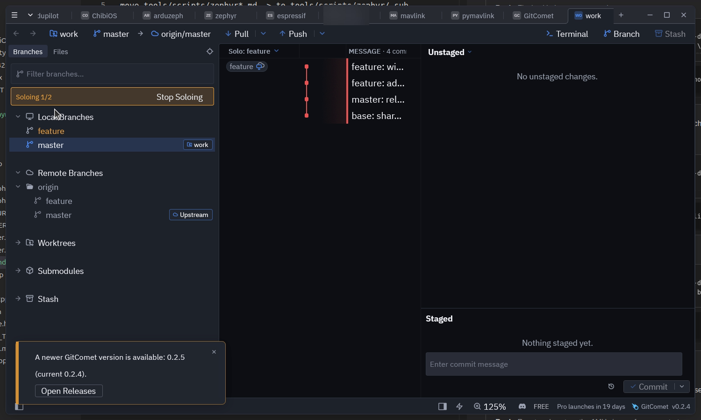
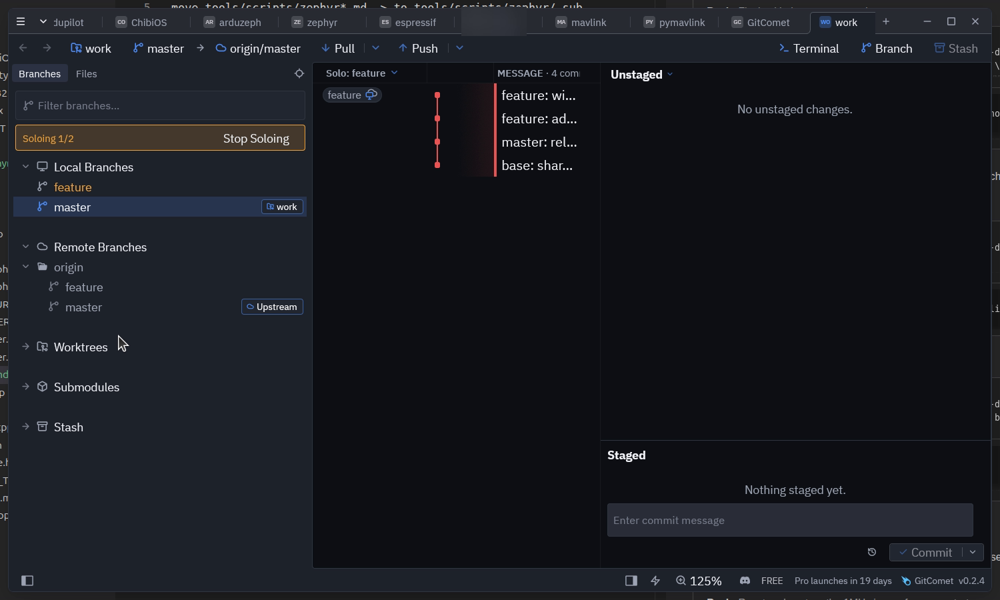
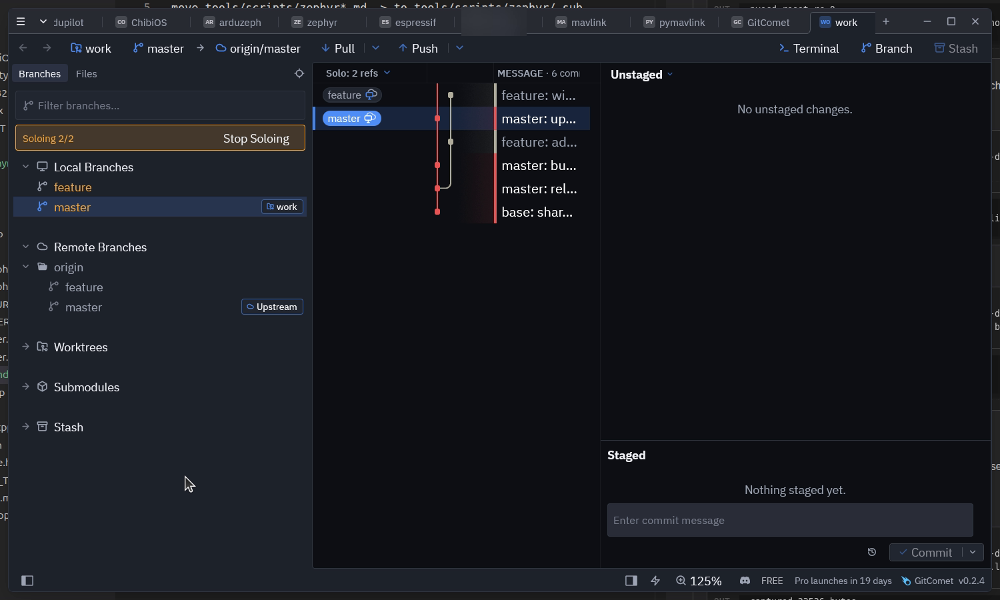
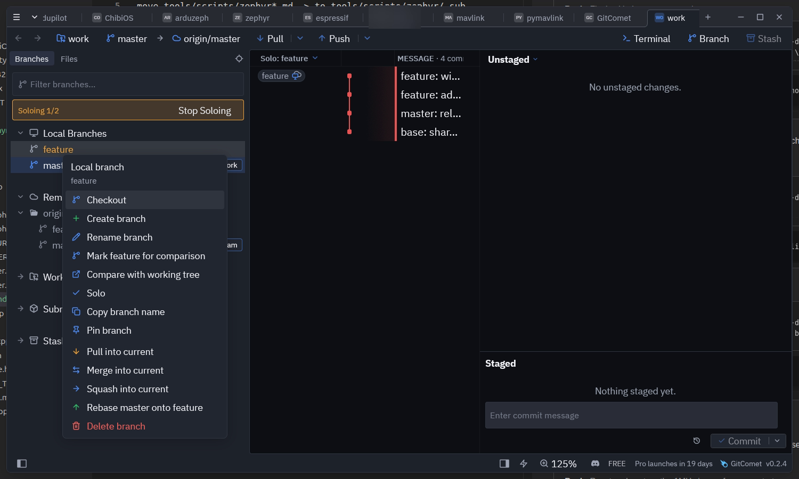

# Focus

Focus narrows the history to the refs you pick. Right-click a local branch, a
remote branch or a remote in the sidebar and choose **Focus**: the history walk
is reseeded from that ref, so the graph shows only the commits it reaches. On a
focused ref the same entry reads **Stop focus** and takes it back out.

The entry also appears on the ref badges in history rows, which reuse the
branch menu.

## What it does to the walk

Focus replaces the walk's *seed*, not its *mode*. A focused first-parent walk
still follows first parents; it just starts at the focused ref instead of HEAD.
So focus composes with every entry in the history-mode menu rather than
competing with it.

Focusing one branch leaves the branch and everything it reaches:

## Focusing several refs

Focus is a set. Each menu entry toggles its own ref, and the walk seeds from all
of them, so focusing two branches shows the union of what they reach — which is
how you read two lines of development with the rest of the repository out of
the way.

Focusing a whole remote seeds from every branch that remote tracks, including
ones fetched later. Its branches read as focused; stopping focus on one of them
keeps the rest of the remote in view.

## Branch groups

A branch group's menu (`feat/`, `origin/feat/`) offers **Focus group**, which
adds every branch in the group, and **Stop focusing group**, which takes them
all out. A group that is only partly focused offers both. While the branch
filter is active, the group entries act only on the branches the filter shows.

## The eye column

While anything is focused, every branch, group and remote row in the sidebar
gets an eye on its left:

- an open eye in the theme's accent colour: focused;
- a dim open eye: a group or remote with only some of its branches focused;
- a crossed-out eye: not focused.

Clicking an eye focuses or unfocuses that row without selecting it. A group's
eye focuses all of its branches, or unfocuses them all when every one already
is.

## Finding your way out

Focused rows are drawn in the theme's accent colour, and an accent banner above
the branch list reads `Focusing x/y` — focused branches over all local and
remote branches — with **Stop focus** to clear the set in one click.

The history header chip names the focused ref, or counts them when there are
several (`Focus: 8 refs`). Its menu shows the same count and can stop focus too.

## Notes

- The focus set is remembered per repository, alongside the history mode and
  the author filter.
- A focused ref that is deleted or pruned drops out of the set on its own, and
  the rest of the focus stands.
